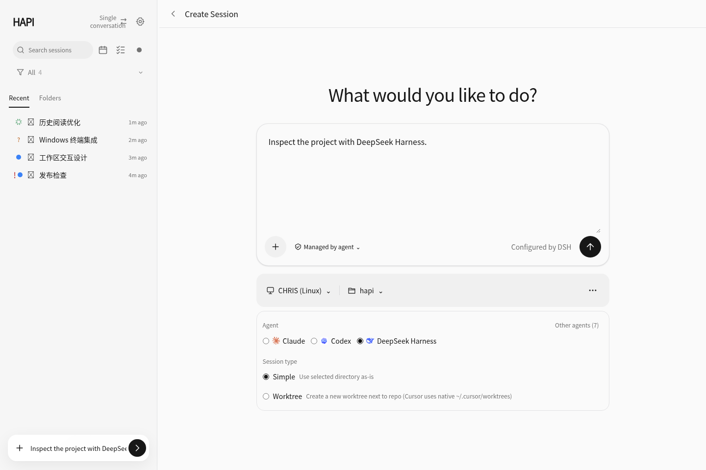
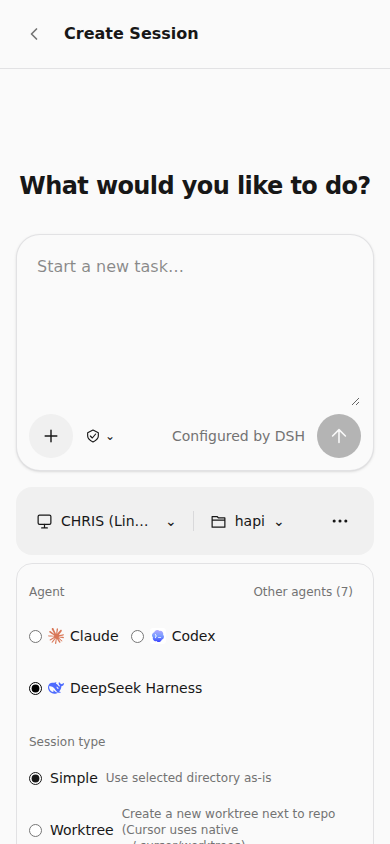
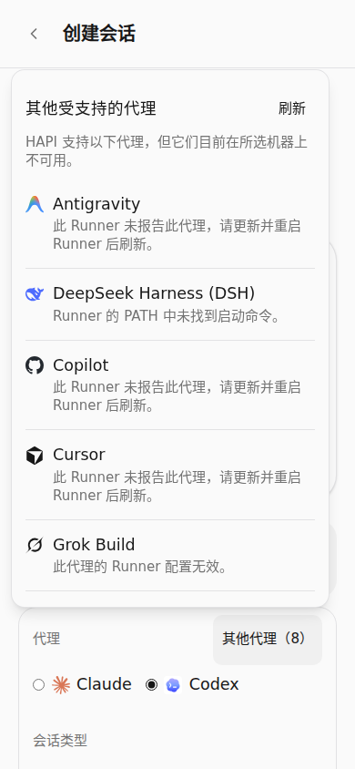

# DSH launcher and Web discovery follow-up

Audited on 2026-10-19 from HAPI `ecfe61a05f1530142997caaf8616e02036f55777`.

## Confirmed failure

The new-task screenshot showed only Claude and Codex on CHRIS. HAPI already had
the DSH flavor, command registration, runner/Hub spawn path and ACP lifecycle,
but two actual implementation problems could hide an installed DSH:

1. Both command discovery and the backend defaulted to `dsh-acp-demo`. The
   current official package publishes `dsh`, whose ACP entry is
   `dsh --profile acp`. A directory containing only `dsh` therefore failed
   HAPI's executable check.
2. The Web form filtered out unavailable agents and discarded their reported
   reasons. Missing commands, invalid configuration and an older runner that
   omitted DSH all looked like absent product support.

The earlier workbench audit incorrectly listed the modern launcher as already
implemented. Its lifecycle row now points to this correction. We did not
inspect CHRIS's live installation, PATH or running CLI version; the screenshot
alone cannot establish which additional host-side update it needs.

## Source evidence

The upstream revision is the same one used in the original harness audit:

- [Official CLI documentation](https://github.com/deepseek-ai/deepseek-harness/blob/687f282e8625c6b8d11ff58211a90524be2e4317/apps/cli/README.md)
  identifies `dsh` as the launcher and ACP as a built-in, automatically
  initialized stdio profile.
- [CLI package manifest](https://github.com/deepseek-ai/deepseek-harness/blob/687f282e8625c6b8d11ff58211a90524be2e4317/apps/cli/package.json)
  publishes the `dsh` binary.
- [Launcher argument parser](https://github.com/deepseek-ai/deepseek-harness/blob/687f282e8625c6b8d11ff58211a90524be2e4317/apps/cli/src/args.ts)
  uses `--patch` for configuration overlays.
- [Root manifest](https://github.com/deepseek-ai/deepseek-harness/blob/687f282e8625c6b8d11ff58211a90524be2e4317/package.json)
  provides the `dsh` source script and has no `demo:acp` script.
- The checksum-verified npm artifact
  [`@deepseek-ai/dsh@0.2.0-rc.2`](https://registry.npmjs.org/@deepseek-ai/dsh/-/dsh-0.2.0-rc.2.tgz)
  was also inspected. Its unmodified launcher ran `--version` and `--help`
  successfully with an isolated set of launcher dependencies. The help
  advertises both profile and patch flags.

## Corrected behavior

| Area | Result |
| --- | --- |
| Default discovery and launch | Share one command resolver; recognize `dsh` and start `dsh --profile acp` |
| Explicit official executable | Absolute paths and Windows `.exe`, `.cmd`, `.bat` names receive the ACP profile arguments |
| Optional configuration | The official launcher receives `--patch`; explicit custom ACP executables keep their existing `--config` contract |
| Explicit JSON arguments | Exact override, including `[]`; an ignored config path no longer fails preflight validation |
| Main Agent row | Select only agents reported available by the chosen runner |
| Other agents | One collapsed entry shows command-not-found, invalid-config, not-reported or unspecified-unavailable status, with a refresh action |
| Refresh | Newly available DSH appears without taking over the selected agent |
| DSH launch settings | Show the DSH-managed model and permission summaries; omit unsupported model/effort/YOLO/permission fields from task creation |
| Running sessions | Retain server-advertised model and reasoning controls |
| Small screens and keyboard | Constrain the popover to its available viewport space; focus and scroll its list, then return to its trigger with Escape |

There is no implicit fallback to the retired demo. An explicitly configured
custom executable remains supported. No existing test was removed, skipped or
weakened to hide a production failure.

## Verification

Before production edits, 22 focused launcher/availability cases produced
**13 failures and 9 passes**. The failures included the official executable
being reported as not found, missing ACP profile arguments and an ignored
stale config being reported as invalid.

After the correction:

| Check | Result |
| --- | --- |
| DSH, availability, runner arguments, command parsing, resume and ACP tests | 104 passed across 8 files |
| Agent selector, new-session form and existing DSH session-control tests | 110 passed across 4 files |
| Chromium task/discovery and responsive acceptance | 4 passed: desktop, 390px phone, 320px phone with larger text, Chinese with larger text |
| CLI and Web typechecks | Passed |
| Web production build and existing asset-size budget | Passed |
| Diff whitespace check | Passed |

The CLI regression puts an executable named only `dsh` on an isolated PATH and
starts a real child process through `AcpSdkBackend` and the stdio transport. It
checks the exact ACP arguments, `initialize`, and `session/new`. The child is a
local protocol fixture, not a live DSH provider session.

The browser spec uses the production router, form, query hooks, API client and
initial-task delivery. Only the Hub boundary is simulated. It checks unavailable
reasons, refreshed selection, exact spawn fields and delivery/navigation. Phone
cases also exercise keyboard scrolling, focus restoration, reachable refresh,
available DSH selection and horizontal bounds. The new spec is included in the
existing Dependency UI regression workflow.

The first browser run exposed a real 320px/large-text failure: the popover could
extend above the viewport and hide Refresh. Its height now uses Radix's actual
available space in addition to the normal maximum; the failing bounds assertion
was retained. An incomplete Codex-history fixture response was corrected
separately, while keeping the assertion that every API request is handled.

## Screenshots

These are unmodified Chromium captures of the production UI with the simulated
Hub, not captures from CHRIS's live environment.

## Remaining deployment and runtime verification

CHRIS must run the corrected HAPI CLI and have DSH installed or an explicit ACP
command in its runner environment. Updating Web assets alone cannot change
another machine's CLI or PATH. The [agent guide](../guide/agents.md#deepseek-harness)
documents installation, configuration and restarting the existing runner or
service while retaining its workspace-root options.

A complete official DSH ACP profile and authenticated model turn were not run.
The official executable's help/version, upstream protocol source, HAPI's real
stdio transport and Web spawn/delivery contract were verified separately. No
claim is made that CHRIS's live provider configuration has been exercised.
