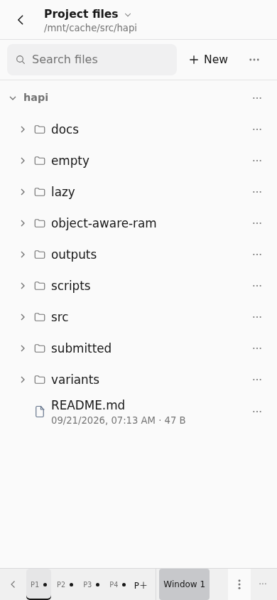
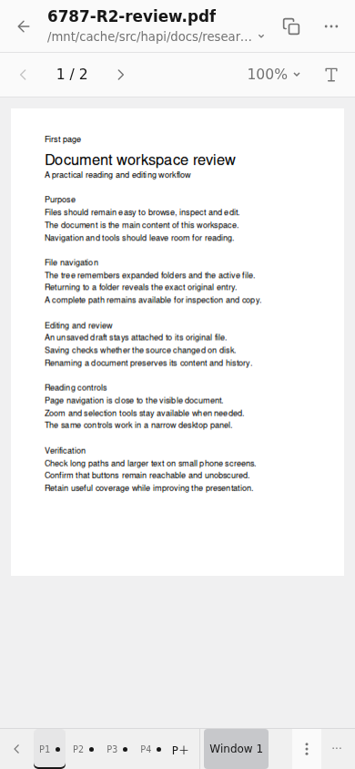
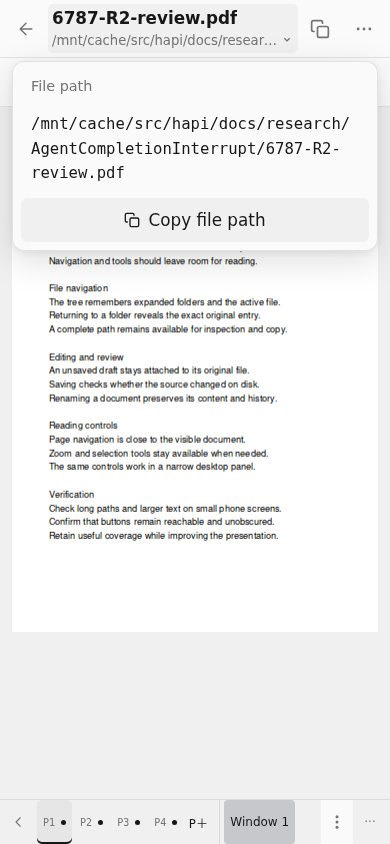

# 文件工作台：布局收敛与验证

本轮集中改进 Web 文件树和阅读器的层级：让文件列表、正文占据主要空间，把低频操作放进菜单。保留既有文件管理、草稿和工作区行为。

## 实际界面

以下截图来自生产组件和本地模拟 Hub，尺寸为 **390 × 844**；同时验证了 **320 × 568**、桌面及窄分栏。环境为 Chromium **156.0.8078.4**、Codex 主题、实际 **120% 字号**。使用真实 PDF 渲染和原有底部窗格栏。

### 文件树



### PDF 阅读器



### 完整路径



## 层级与保留的能力

| 界面 | 常驻内容 | 按需显示 |
| --- | --- | --- |
| 文件树 | 项目位置、搜索、新建入口 | 上传、排序、隐藏文件、过滤、批量操作 |
| 文件阅读器 | 返回、文件名、路径、复制；编辑时保存 | 重新读取、下载、固定、关闭和其他文档操作 |
| PDF | 翻页、页码、缩放比例、选择工具 | 缩放调节、文字或区域选择 |

普通文件行不再常驻复选框；选择模式、长按和菜单仍可进入批量操作。文件树保留懒加载、展开状态、搜索，以及新建、上传、重命名、移动、复制、删除和下载。手机行高为 **44px**，主要触控入口至少 **44px**。

文件名和路径合并在同一标题区域，路径复制始终可见；点击标题可查看、选择和复制完整路径。返回文件树仍展开父目录、选中并滚动到原文件。返回和切换窗格保留草稿、编辑状态及未保存内容；显式关闭继续提供保存、保留或放弃的选择。

手机阅读时收起重复的工作区标题与空工具条，单文件不再重复显示标签栏；多文件切换仍可用。PDF 正文在两种手机尺寸、120% 字号下从约 **y = 119.3px** 开始。底部窗格栏已通过真实点击验证：切换 P2/P1 后能回到原 PDF。窄桌面窗格按容器宽度调整布局。

## 修复与删除依据

- PDF、图片等渲染器不再显示无效的通用 Find。纯 ASCII PDF 即使被识别为 UTF-8 且文件系统允许写入，也不会显示无效的 Save/Saved；已有脏草稿的保存通路保留。
- Find 菜单关闭后焦点进入真实 CodeMirror 搜索框。文件树焦点、窗格切换和后台弹层得到回归验证；隐藏窗格会关闭其路径、操作、缩放和选择菜单，避免悬浮在其他窗格上或抢回焦点。
- `files.tsx` 的旧 `DirectorySortMenu`、局部 `SearchIcon` 已由新工具栏承接。旧搜索/排序样式及 `.file-workbench-toolbar` 的对应 DOM 已移除；对 `web/src` 检索 `DirectorySortMenu`、`.app-files-search-input`、`.app-files-search-clear`、`.app-file-sort-option` 和 `.file-workbench-toolbar` 均无剩余引用，才删除旧辅助代码、选择器和空置文案。
- **未删除测试。** 单文件路由在此前版本已使用保留式工作台，旧 Back 离开测试的入口过时；改由“关闭文件”验证原有取消、显式放弃及不写入磁盘的断言。日期分组夹具从 UTC 零点改为本地正午，使数据符合按本地日历分组的语义，原断言保留。

## 验证与边界

- 完整 Web 单元测试：**4,738 项通过，430 个测试文件**。
- 最终浏览器回归：**44 项通过，5 个套件**：文件工作台、布局、文档、HTML 和工作区生命周期。覆盖路径复制与定位、草稿、文件操作、窄屏布局、PDF、底部窗格及后台菜单。
- Web 类型检查、生产构建通过。

可在仓库根目录复跑：

```sh
bun run test:web
bun run typecheck:web
bun run build:web
bunx playwright test e2e/workspace-lifecycle.spec.ts e2e/file-workbench.spec.ts e2e/file-workbench-layout.spec.ts e2e/document-workspace.spec.ts e2e/html-document.spec.ts
```

日期夹具还分别在 `TZ=UTC` 与 `TZ=America/Los_Angeles` 下通过全部 6 项测试。新增布局和文档回归已纳入现有浏览器 CI。

本次修改范围为 Web。浏览器夹具使用模拟 Hub，不等同于物理设备验收；尚未在真实 Android/iOS 设备上验证。未改动原生壳、原生扩展或热更新协议。
